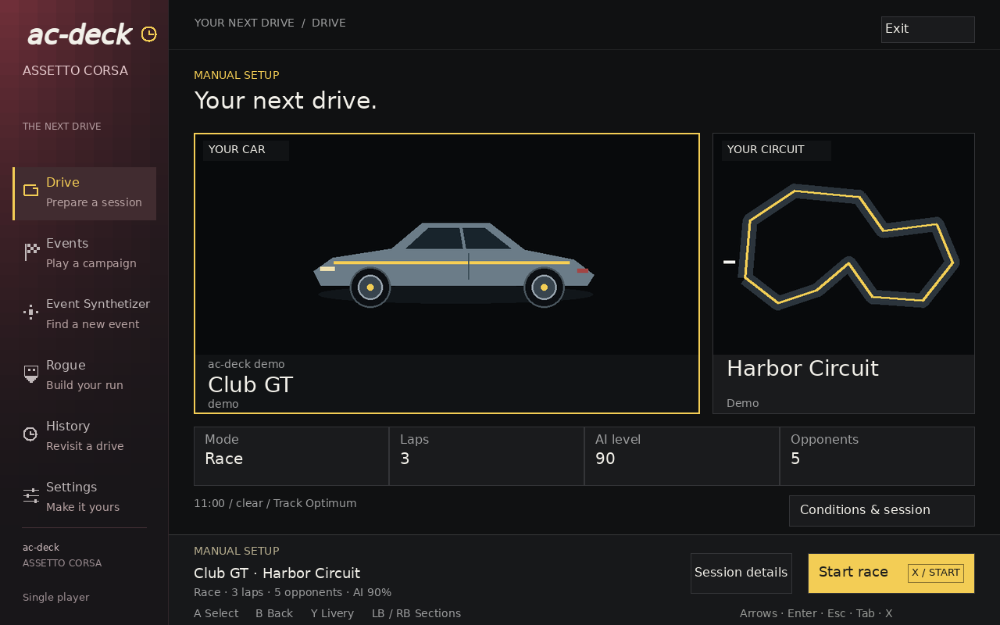
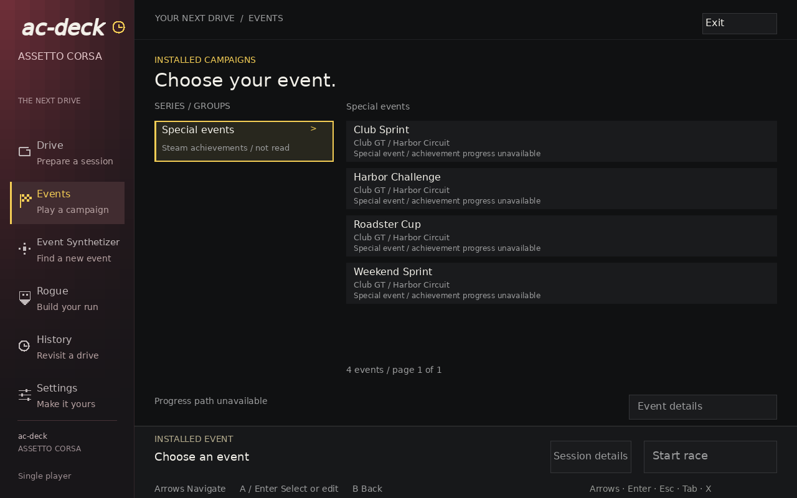
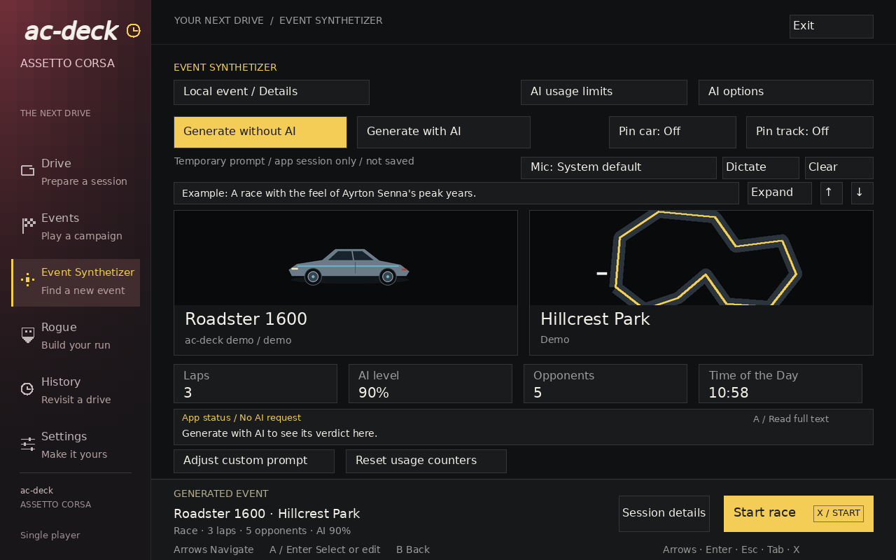
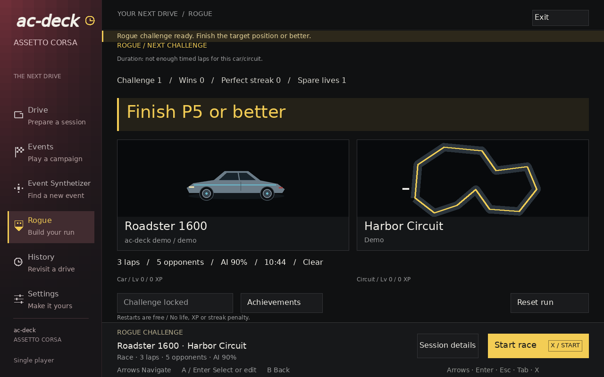
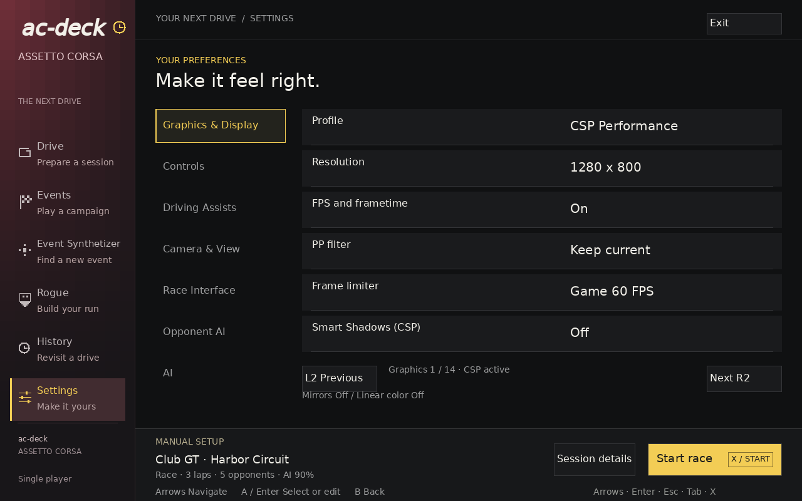

# ac-deck

A controller-friendly launcher for the original Assetto Corsa on Steam Deck.

**Source-available:** source is available in this repository under [PolyForm Noncommercial 1.0.0](LICENSE), alongside the community builder, synthetic tests and interface previews. A runtime package is not published: review of bundled LGPL components remains pending. Physical Steam Deck validation has not yet been performed.

[](docs/screenshots/ac-deck-drive-1920x1200.png)

Captured from the current SDL renderer using demonstration data and original schematic illustrations. These previews show the interface; real races and Steam Deck performance require separate validation. Click an image for its 1920 × 1200 version.

## Features

| Area | Existing launcher functionality |
| --- | --- |
| Drive | Browse installed cars and tracks and configure a manual session. |
| Events | Browse events from installed campaigns. |
| Event Synthetizer | Review generated race proposals, with optional AI generation. |
| Rogue | Persistent challenges, progression and rewards. |
| History | Inspect recorded attempts and restore race setups. |
| Settings | Configure graphics, controls, assists and optional AI features. |

The launcher uses the original simulator through Steam/Proton. Cars, tracks and other installed content come from the player's installation.

## Gallery

| Events | Event Synthetizer |
| --- | --- |
| [](docs/screenshots/ac-deck-events-1920x1200.png) | [](docs/screenshots/ac-deck-synth-1920x1200.png) |

| Rogue | Settings |
| --- | --- |
| [](docs/screenshots/ac-deck-rogue-1920x1200.png) | [](docs/screenshots/ac-deck-settings-1920x1200.png) |

[Capture provenance and image manifest](docs/screenshots/README.md).

Community builds use native graphics profiles by default. CSP-related controls
shown in the previews require a separately supplied CSP kit; CSP is not bundled.

## Requirements

- Steam Deck running SteamOS/Linux.
- Steam and a legitimate copy of the original Assetto Corsa, plus any DLC required by the selected content.
- The game installed and working with the player's Steam/Proton setup.
- Optional AI generation and dictation require their configured services, network access and API credentials.

The candidate targets Linux x86_64 and requires GLIBC 2.39. Python 3.13.5 is a source-build requirement; the compiled candidate includes its Python runtime. No public SteamOS/Proton compatibility matrix has been validated yet.

## Installation and updates

Start with the [installation guide and current availability](docs/installation.md). See [updates and recovery](docs/update-and-recovery.md) for data preservation and [troubleshooting](docs/troubleshooting.md) for reporting a problem.

The [source inventory](public-source-manifest.json) records the reviewed launcher export. Game/DLC files, Steam data, CSP archives and third-party mod/media payloads are outside the community distribution. The public package must pass the [community release checklist](docs/community-release-checklist.md) before installation or compatibility claims are marked verified.

For development, use Python **3.13.5** and the [hash-pinned dependencies](scripts/launcher-linux-requirements.txt), then run from the repository root:

```sh
python -B -m unittest discover -s tests -v
```

A local candidate has passed the [documented build checks](docs/build-validation.md).
Binary distribution remains unavailable pending LGPL compliance review. Physical Steam Deck validation remains separate.

The [source build guide](docs/installation.md#building-from-source) documents the real `--community` builder and its explicit native-library, font and license inputs.

## License

Project-owned code is licensed under [PolyForm Noncommercial License 1.0.0](LICENSE). This is a source-available license with purpose restrictions. It permits noncommercial purposes and the specified personal uses without an anticipated commercial application. It also permits use by charitable organizations, educational institutions, public research organizations, public safety or health organizations, environmental protection organizations and government institutions, regardless of their funding source or obligations resulting from that funding. Fair-use rights remain unaffected.

Read the full license for the exact permissions, conditions and required notices. Third-party components retain their own terms; see [third-party notices](THIRD_PARTY_NOTICES.md).

## Follow and contribute

Follow [this repository](https://github.com/alexandrefortes/ac-deck) for documentation and release updates. Documentation corrections, reproducible bug reports and focused feature proposals are welcome through [GitHub issues](https://github.com/alexandrefortes/ac-deck/issues).

For a bug report, include the version, SteamOS/Proton versions, steps to reproduce, expected result and actual result. Remove API keys, account details and private paths from screenshots and logs.

Read [CONTRIBUTING](CONTRIBUTING.md) for source checks and contribution scope. Package licensing compliance and physical validation remain part of the release checklist.
